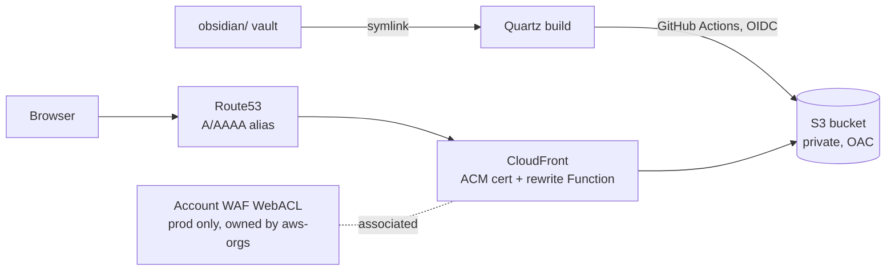

# notes

Source for [notes.rickwaterman.com](https://notes.rickwaterman.com) — Rick Waterman's
engineering knowledge base: terse, example-first reference notes on AWS, distributed
systems, databases, DevOps tooling, security, and the command line.

The notes are an [Obsidian](https://obsidian.md/) vault (`obsidian/`) published as a static
site with [Quartz](https://quartz.jzhao.xyz/) v5 (`quartz/`) and deployed to S3 +
CloudFront with AWS CDK (`infra/`). It is a sibling of
[`website`](https://github.com/rwaterman/website) and
[`blog`](https://github.com/rwaterman/blog), which share the same deployment pattern. Each
AWS account (`rwaterman-dev`, `rwaterman-prod`) owns its account-wide infrastructure in the
`aws-orgs` repo, and this repo deploys one stage per account.

## Requirements

- Node.js 22 (`quartz/.node-version`)
- `yq` (CI uses it to set `baseUrl` per environment)
- AWS CLI + CDK bootstrap in `us-west-2` and `us-east-1` of both `rwaterman-dev` and
  `rwaterman-prod` for infra work

## Write notes

Open `obsidian/` as a vault in Obsidian. Plain Markdown with wikilinks, callouts, and
frontmatter (`title`, `description`, optional `date`). `obsidian/index.md` is the site
home page and the hand-curated map of content; add new notes to the matching topic
folder and link them from there.

Folders ignored at build time (`ignorePatterns` in `quartz.config.yaml`): `private`,
`templates`, `Unsorted`, `.obsidian`. Drop half-finished notes in `Unsorted/` and they
stay out of the published site.

`obsidian/ai-disclosure.md` describes how AI tools are used.

## Develop

```sh
cd quartz
npm ci
npx quartz plugin install   # fetches github:quartz-community/* plugins into .quartz/plugins
npx quartz build --serve -d ../obsidian   # http://localhost:8080, rebuilds on change
```

`quartz/content` is a symlink to `../obsidian`, so the vault is the single source of
truth and Quartz reads it in place. Build with `-d ../obsidian` rather than through the
symlink: the created-modified-date plugin resolves git history by path, and
`content/...` is not a tracked path, so every note would get the checkout time.

## Layout

```
.obsidian/                shared vault settings (workspace state is gitignored)
obsidian/                 the vault — published content
  index.md                home page / map of content
  AWS/ AI/ CLI/ Databases/ DevOps/ Operating Systems/ Programming/
  Security/ Software Architecture/ Sources/ Unsorted/
quartz/                   Quartz v5 (vendored upstream + config)
  content -> ../obsidian
  quartz.config.yaml      site config, theme, plugin list
  quartz.lock.json        pinned plugin versions
  plugins/search-shortcut local component plugin: "/" opens search (hand-written dist/, no build)
  public/                 build output (gitignored)
infra/                    AWS CDK app (TypeScript)
  bin/
  lib/shared-stack.ts     notes-infra-deploy role, imports the account's OIDC provider (us-west-2)
  lib/cert-stack.ts       stage ACM certificate (us-east-1)
  lib/site-stack.ts       one stage (us-west-2)
  lib/stage-stacks.ts     builds the three stacks for one stage
  lib/site-config.ts      STAGES (account, zone, domain), resolveStage()
  test/                   stage-config and site-stack tests (npm test)
.github/workflows/
  deploy.yml              build + publish content
  infra.yml               cdk deploy
```

## Site

Quartz is configured in `quartz/quartz.config.yaml` (v5 YAML config; plugins are
`github:quartz-community/*` packages pinned in `quartz.lock.json`). Notable choices:

- Title "Engineering Knowledge Base", `baseUrl` rewritten per environment by CI.
- Nord palette, locked to dark mode via the `quartz-themes` preset; Space Grotesk /
  Inter / JetBrains Mono from Google Fonts.
- Explorer, full-text search (`/`), graph view, backlinks, breadcrumbs, link popovers,
  SPA navigation, syntax highlighting, created/modified dates from frontmatter → git →
  filesystem, RSS + sitemap, OG images.
- Plausible analytics.

## Architecture



The home region is `us-west-2`; everything that can live there does (bucket,
distribution, roles, SSM). CloudFront requires its ACM certificate in `us-east-1`, so
each environment gets a thin `NotesCert<Env>` stack there whose certificate is passed to the
home-region site stack with CDK `crossRegionReferences`. DNS is the stage account's own
hosted zone: `dev.rickwaterman.com` in `rwaterman-dev` and `rickwaterman.com` in
`rwaterman-prod`.

| Stack | Region | Contents |
| --- | --- | --- |
| `NotesShared` | us-west-2 | `notes-infra-deploy` role (imports the account baseline's OIDC provider) |
| `NotesCert<Env>` | us-east-1 | That environment's DNS-validated ACM certificate |
| `NotesSite<Env>` | us-west-2 | Bucket, distribution, DNS, content role, SSM params |

### `NotesShared`

Imports the account's GitHub OIDC provider (owned by the account baseline in `aws-orgs`) and
creates the `notes-infra-deploy` role that `infra.yml` assumes. The role trusts only the
GitHub environment subject `repo:rwaterman/notes:environment:<stage>`. It has no service
permissions of its own — it can only assume the CDK bootstrap roles in both regions.

### `NotesSite<Env>`

| Env | AWS account | Stack | Domain | Hosted zone | GitHub environment (branch) | Content role | Web ACL |
| --- | --- | --- | --- | --- | --- | --- | --- |
| dev | `rwaterman-dev` (690084476262) | `NotesSiteDev` | `notes.dev.rickwaterman.com` | `dev.rickwaterman.com` | `dev` (`develop`) | `notes-content-dev` | no |
| prod | `rwaterman-prod` (582621605246) | `NotesSiteProd` | `notes.rickwaterman.com` | `rickwaterman.com` | `prod` (`main`) | `notes-content-prod` | yes |

Each environment stack creates: a private, encrypted S3 bucket (prod: `RETAIN`, dev:
destroy + auto-empty); a CloudFront distribution with Origin Access Control, a
viewer-request CloudFront Function that maps `/foo/` to `index.html` and extensionless
`/foo` to `foo.html` (Quartz emits flat pages), and 403/404 mapped to Quartz's
`/404.html`; Route53 A/AAAA alias records; a
GitHub-environment-scoped OIDC role that may only write to that environment's bucket and
invalidate its distribution; and SSM parameters `/notes/<env>/bucket-name` and
`/notes/<env>/distribution-id` that the deploy workflow resolves at run time.

In prod the distribution attaches the account's CloudFront WebACL (geo-block of sanctioned
countries, per-IP rate limit, AWS IP-reputation list) by reading its ARN from SSM
`/account/cloudfront-webacl-arn` (us-west-2) at deploy time. The account baseline in
`aws-orgs` owns the WebACL, so the rules are defined in one place for all three sites. Dev
sets `webAcl: false` and carries no WebACL.

`-c attachDomains=false` deploys the stack with the certificate but no CloudFront aliases and
no Route 53 records. The prod cutover uses it to verify the site on its `*.cloudfront.net`
domain before the domain moves.

## CI/CD

Both workflows use OIDC (`id-token: write`) and each job runs in the GitHub environment
that matches its target: `dev` (deploys from `develop`, AWS account `rwaterman-dev`) or
`prod` (deploys from `main`, AWS account `rwaterman-prod`). Each environment carries the
variable `AWS_ACCOUNT_ID`, and the roles trust only that environment's OIDC subject. No
long-lived AWS keys exist.

- **`deploy.yml`** — on push to `develop` (→ dev) or `main` (→ prod), or
  `workflow_dispatch` with an `env` choice. Checks out full history (`fetch-depth: 0`,
  so created/modified dates come from git), restores the plugin cache (keyed on
  `quartz.lock.json`), runs `npm ci` + `quartz plugin install`, sets `baseUrl` with `yq`,
  runs `quartz build -d ../obsidian`, writes `robots.txt` (`Disallow: /` on dev, `Allow: /` + sitemap on
  prod), assumes `notes-content-<env>`, syncs `quartz/public/` to S3 with
  `must-revalidate` cache headers, then invalidates `/*`.
- **`infra.yml`** — on push to `develop` or `main` touching `infra/**`. Runs `npm test`,
  assumes `notes-infra-deploy` and runs `cdk deploy --all -c stage=<dev|prod>` for the
  branch's stage only. `develop` never touches prod.

Branching follows git flow: feature branches → `develop` (dev), releases → `main` (prod).

### Local infra work

The CDK app requires `-c stage=dev|prod` and throws when `CDK_DEFAULT_ACCOUNT` (the
credentials' account) differs from the stage's account, so dev config cannot deploy with
prod credentials or the reverse. Both regions must be CDK-bootstrapped in the target account.

```sh
cd infra && npm ci
npm test
npx cdk synth -c stage=dev --profile rwaterman-dev
```

`notes-infra-deploy` is created by `NotesShared`, so the very first deploy of a stage runs
locally with admin credentials, after the account baseline in `aws-orgs` exists:

```sh
npx cdk deploy --all -c stage=dev --profile rwaterman-dev
npx cdk deploy --all -c stage=prod --profile rwaterman-prod   # prod: confirm first
```
